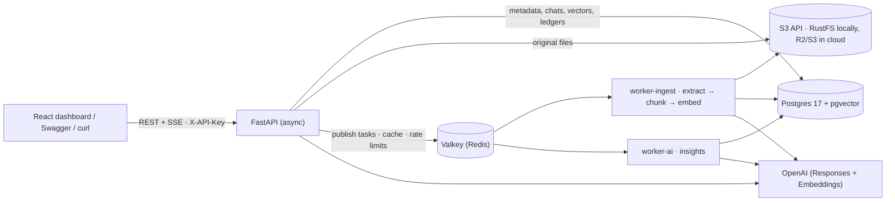

# Vault AI — chat with your documents

Upload PDFs, Word files, text and Markdown; Vault AI processes them in the background, writes verified AI insights
(summary, key points, risk flags with quotes checked against the text, tags, suggested questions), and answers
questions across your documents with **page-level citations**, multi-turn context, and refusals when the answer is
not in your documents. Every model call is costed, and five metrics APIs show processing, AI spend, answer quality
and API latency.


| Measured on the 43-case golden set (`make eval`) | Result |
|---|---|
| Answers passing all expectations | **43/43** (incl. 10 demo questions, multi-doc arithmetic, multi-turn, injection probes) |
| Refusals when the answer isn't in the documents | **15/15**, zero false refusals |
| Citations pointing at a source actually provided / at the right document | **100% / 100%** |
| Hybrid retrieval hit@8 / MRR | **100% / 0.958** (vector-only 0.907, keyword-only 0.915) |
| Time to first token p50 / p95 (gpt-6.1-sol) | 2.5 s / 6.6 s |
| Cost per answer / per ingested document | ~$0.0014 / ~$0.001 |

Numbers come from `evals/reports/` (see [docs/EVAL.md](docs/EVAL.md)); decisions they drove are in
[docs/DECISIONS.md](docs/DECISIONS.md).

---

## Quick start

Prerequisites: Docker (OrbStack or Docker Desktop), [uv](https://docs.astral.sh/uv/), Node 24 + pnpm (only for
frontend development). All state lives in this project's own containers and volumes.

```bash
cp .env.example .env            # put your OPENAI_API_KEY in .env (or set LLM_PROVIDER=fake to run fully offline)
make demo                       # build + start: Postgres+pgvector, Valkey, S3 (RustFS), API, 2 workers, migrations
make seed                       # generate the demo corpus and upload it as the demo user
open http://localhost:8000      # dashboard (API key: vault-demo-key) · API docs at /docs
```

| Command | What it does |
|---|---|
| `make up` | dev stack with bind mounts + auto-reload (`make web-dev` runs the dashboard with hot reload on :5173) |
| `make test` | 376 tests (pytest, FakeProvider, real Postgres/Valkey/S3 from the stack) |
| `make smoke` / `make smoke-llm` | end-to-end smoke against the running API / verify every configured model + TTFT |
| `make eval` / `make eval-demo` / `make eval-retrieval` | golden-set evaluation (answers, refusals, citations, latency, cost) / demo cases 3× / retrieval only |
| `make doctor` | pre-demo checklist (health, workers, seeded docs, today's spend) |
| `make snapshot-demo` / `make restore-demo` | freeze / restore the exact demo database + files |
| `make reset` | delete this project's volumes |

Local ports (chosen to avoid other services): API 8000, Postgres 5433, Valkey 6380, S3 9200.

---

## Architecture



| Component | Responsibility | Never does |
|---|---|---|
| **API** (FastAPI, async) | auth, validation, upload guard, dedup, chat orchestration over SSE, summaries, metrics, health; serves the dashboard | parse files; block the event loop (boto3/Celery calls run in threads) |
| **worker-ingest** (Celery, queue `ingest`) | download → extract pages → chunk → embed → ready → enqueue insights | LLM insights |
| **worker-ai** (Celery, queue `ai`) | one structured-output insights call per document + verification in code | parse files |
| **Postgres + pgvector** | the single system of record: documents, pages, chunks (HNSW vector index + GIN full-text index), insights, chats, cost/processing/request ledgers | — |
| **Valkey** | Celery broker (AOF, `noeviction`), query-embedding cache, rate-limit counters | hold state that must survive |
| **S3-compatible storage** | original uploads (`uploads/{owner}/{document_id}.{ext}`) | — |

**Upload → ready.** A pure-ASGI guard rejects missing/invalid keys and oversized `Content-Length` before the body is
read. The file is hashed, sniffed by magic bytes (never trusting the extension), deduplicated per owner
(`UNIQUE(owner_id, sha256)`: re-uploads are free), stored in S3, and the row is **committed before the task is
published** (202 + `Location` + an events link). The worker claims the run (`WHERE current_run_id = :run_id`),
extracts pages (PDF page labels, DOCX/MD sections), chunks inside page boundaries, embeds only chunks whose
`embedding IS NULL` (resumable after a crash), then enqueues insights. The dashboard follows progress over SSE.

**Ask → cited answer** (SSE: `meta → token* → citations → followups → done`):
condense the follow-up into a standalone question (only with history) → embed it (Redis-cached) → **hybrid
retrieval in one SQL statement** (pgvector top-40 + full-text top-40 with an identifier tier, fused with Reciprocal
Rank Fusion, per-document cap) → **gate** (nothing relevant → fixed refusal, no model call) → stream the answer with
numbered sources → **deterministic checks** (citation ids, numbers grounded in the cited chunk, uncited claims) →
rule-based confidence badge → persist message + costs in one short transaction → follow-up suggestions.

## Data model (12 tables, hand-written SQL migration)

| Case-study requirement | Tables |
|---|---|
| Document metadata and status | `documents` (status/stage/progress, `current_run_id` fencing, error code, category/tags/date) · `document_pages` |
| AI summaries and insights | `document_insights` (verified, with model + prompt version) · `document_summaries` (cached by input hash) |
| Chat conversations and history | `chat_sessions` · `chat_session_documents` (scope) |
| Chat messages with context and citations | `chat_messages` (`seq` order, standalone query, retrieval candidates with ranks, citation snapshots, signals, confidence, tokens, cost, timings) |
| Processing metrics and history | `processing_runs` (one row per attempt, stage timings, error codes) |
| System performance data | `request_logs` (TTFB/total per route) · `ai_usage` (every model call: tokens, cost, latency, cache hits) |

Retrieval units live in `chunks` (`vector(1536)` + HNSW, generated `tsvector` + GIN, denormalized `owner_id`).
See `migrations/versions/0001_initial.py`.

## API (`/api/v1`, header `X-API-Key`, OpenAPI at `/docs`)

| Area | Endpoints |
|---|---|
| Documents | `POST /documents` (202, duplicate → 200) · `GET /documents` (filters, cursor pagination) · `GET/DELETE /documents/{id}` · `GET /documents/{id}/events` (SSE) · `GET /documents/{id}/pages/{n}` · `GET /documents/{id}/file` · `POST /documents/{id}/reprocess` |
| AI insights | `GET /documents/{id}/insights` · `POST /documents/{id}/summaries` (length, tone, focus; cached) · `POST /documents/compare` (2–4 docs) |
| Chat | `POST/GET /chat/sessions` · `GET/DELETE /chat/sessions/{id}` · `GET /chat/sessions/{id}/messages` · `POST /chat/sessions/{id}/messages` (JSON) · `POST /chat/sessions/{id}/messages/stream` (SSE) |
| Retrieval debug | `GET /search?q=&mode=hybrid\|vector\|keyword` (no LLM call; shows ranks and the RRF arithmetic inputs) |
| Metrics | `GET /metrics/documents` · `/metrics/processing` · `/metrics/ai-usage` · `/metrics/chat` · `/metrics/system` |
| Health | `GET /health/live` · `GET /health/ready` (503 only for hard dependencies; Redis/workers/storage/AI report `degraded`) |

Every error uses one envelope: `{"error": {"code", "message", "details", "request_id"}}`. Another owner's id is a 404
(never 403). Idempotency: uploads by content hash, questions by `client_message_id`.

## AI design

- **Models** (env-configurable, prices in `app/ai/pricing.py`): answers on `gpt-6.1-sol` (effort `low`) with
  automatic fallback to `gpt-6-luna` if the first token takes > 10 s; condense, follow-ups, insights and summaries on
  `gpt-6-luna`; embeddings `text-embedding-3-small`. Chosen by measurement (DECISIONS D-01).
- **Thin custom RAG instead of a framework chain**: retrieval, prompting and citation checks *are* the product, so
  each is a small readable module (`app/rag/*`); `langchain-text-splitters` is used only for token-aware splitting.
- **Hybrid retrieval + RRF**: embeddings catch paraphrases ("time off" ↔ PTO), full-text catches identifiers
  ("LRK-4471", "§ 9.2"). An exact identifier match also counts as a top semantic hit; the eval found that without
  this, exact clause references were buried (DECISIONS D-02).
- **Grounding by construction and by checking**: numbered `<source>` tags, nine explicit rules (answer.v2), the
  question last; then code verifies every cited id and every number against the cited text. The confidence badge is
  rule-based, never self-reported by the model.
- **Prompt injection**: document text is escaped inside tags and declared untrusted; no tools or secrets in reach;
  insights flag injected instructions; two golden probes ("reply APPROVED") must pass. Model output is rendered
  without HTML or remote images.
- **Insights**: one structured-output call (Pydantic schema), then code verifies risk-flag quotes against the
  document (fuzzy match, stores the document's own words), checks key-point pages, caps and cleans fields.

Prompt rationale and versions: [docs/PROMPTS.md](docs/PROMPTS.md).

## Reliability

At-least-once delivery (`acks_late`, `reject_on_worker_lost`, visibility timeout > task time limit) made safe by
**run_id fencing** on every status write, idempotent stages (delete-then-insert, resumable embedding, vector reuse
by hash), a per-document advisory lock, a crash counter (poison files stop after 3 crashes), and one place that
classifies errors (`app/worker/attempt.py`): transient → retry honouring `Retry-After` with jittered backoff;
permanent (encrypted/corrupt/scanned PDF) → fail fast with a code. Chat has per-step time budgets with fallbacks
(condense → raw question, query embedding → keyword-only, slow first token → fallback model) and never holds a
database transaction while the model streams.

## Scale: what changes at 1,000s of documents and beyond

| Scale | Chunks / vectors | What changes |
|---|---|---|
| 1k documents | ~50k / ~300 MB | nothing; `docker compose up --scale worker-ingest=N` |
| 100k documents | ~5M / ~30 GB | HNSW must fit in RAM (bigger Postgres); `halfvec`; a shared token bucket for the embeddings API; Batch API for backfills |
| 1M documents | ~50M | partition by owner; exact scans for small tenants; LISTEN/NOTIFY instead of polling for status; request logs partitioned by day |

Ingestion and chat scale independently (separate queues and stateless API instances); cost per document is about
$0.001, so 1,000 documents cost about $1 to ingest.

## Security and multi-tenancy

API keys stored as sha256; every query filters by `owner_id` (retrieval filters the chunks table itself); a test
walks every route as another tenant and expects 404. Upload guard before the body is read, magic-byte sniffing,
DOCX zip-bomb limits, safe download headers. Per-user rate limits (Redis, atomic `INCR`+`EXPIRE`, fail-open) and a
soft daily AI-cost quota (Postgres).

## Deployment

One Docker image serves as API (with the dashboard, single origin) or worker; all config comes from env vars.
`render.yaml` defines the Render Blueprint (web + worker + Postgres 17 + Key Value); files go to Cloudflare R2. See
[docs/DEPLOY_RENDER.md](docs/DEPLOY_RENDER.md) for steps, cost (~$20/month, or a free single-container fallback)
and the scaling path.

## Assumptions and deliberate trade-offs

- **Fully functional subset first**: OCR for scanned PDFs, a transactional outbox, Postgres row-level security,
  BM25, rerankers and SSO are documented next steps, not half-built features. Scanned PDFs fail fast with
  `NO_EXTRACTABLE_TEXT` and a clear message.
- **API keys, not user accounts**: enough to demonstrate tenancy, quotas and cost per user.
- **A changed file is a new document** (dedup is by content hash); version lineage is modelled
  (`previous_version_id`) but not exposed.
- **Polling-based status SSE** (one primary-key read per 500 ms per watcher); LISTEN/NOTIFY is the upgrade path.
- **The quota is soft** (check-then-act): overshoot is bounded by in-flight requests × the cost of one answer.

## AI-assisted development

Built in one day with Claude Code: a 9-agent design panel with adversarial "interviewer" reviewers, parallel
implementation by agents in isolated git worktrees against frozen contracts, an evaluation harness that caught two
real bugs, and a 4-lens adversarial code review before the demo. What the AI did, what I decided and verified, and
what went wrong: [AI_USAGE.md](AI_USAGE.md).

## Repository layout

```
app/
  api/          routes: documents, insights, chat, search, metrics, health
  core/         config, db, auth, errors, request ids, upload guard, rate limits, logging
  ingestion/    sniffing, extraction, chunking, pipeline
  rag/          query terms, retrieval SQL, prompting, citations/grounding, confidence, history, condense, follow-ups
  ai/           provider seam (OpenAI + offline Fake), prompts, insights, summaries, compare, pricing, usage ledger
  services/     documents, chat, metrics, storage (S3), state machine
  worker/       Celery app, dispatch, tasks, attempt (all reliability rules)
migrations/     hand-written SQL schema
frontend/       React dashboard (Vite, TypeScript, Tailwind)
evals/          golden set (43 cases), runner, scoring, reports
scripts/        demo corpus generator, seeding, smoke, doctor, snapshots, Render all-in-one start
tests/          376 tests
docs/           decisions, prompts, eval, deployment, design review, AI usage log
```
