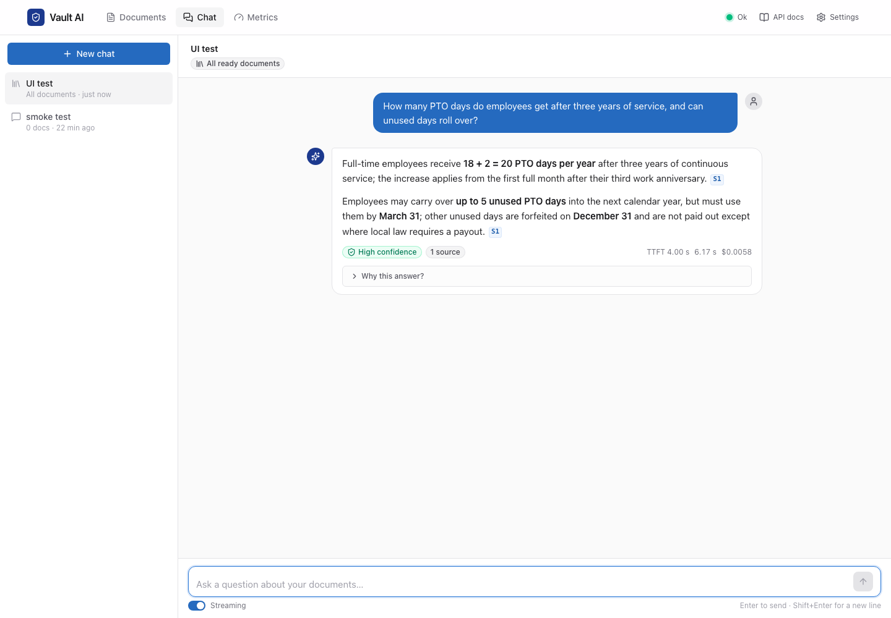
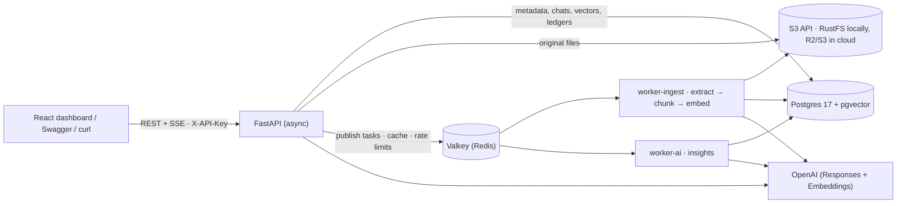

# Vault AI — chat with your documents

Upload PDFs, Word files, text and Markdown; Vault AI processes them in the background, writes verified AI insights
(summary, key points, risk flags with quotes checked against the text, tags, suggested questions), and answers
questions across your documents with **page-level citations**, multi-turn context, and refusals when the answer is
not in your documents. Every model call is costed, and five metrics APIs show processing, AI spend, answer quality
and API latency.



| Final run on the 43-case golden set (`make eval`, 2026-10-14) | Result |
|---|---|
| Answers passing all expectations (first run of each case) | **43/43** (incl. 10 demo questions, multi-doc arithmetic, multi-turn, injection probes) |
| Grounded answers (every number in a cited sentence is in its cited source, a shown calculation, or a date the prompt showed) | **43/43** |
| Refusals when the answer isn't in the documents | **15/15**, zero false refusals |
| Citations pointing at a source actually provided / at the right document | **100% / 100%** |
| Confidence badge high / medium / low | 21 / 7 / 15 (low = the 15 refusals); every answer passed, so each bucket is 100% accurate and the badge's calibration is untested |
| Hybrid retrieval hit@8 / MRR | **100% / 0.958** (vector-only 0.907, keyword-only 0.915) |
| Time to first token p50 / p95 (gpt-6.1-sol, 34 model-generated answers) | 1.4 s / 3.2 s (all 43 answers: 1.4 s / 2.7 s); Sol's latency varies by day; on 2026-10-13: 2.6–2.7 s / 4.7–6.9 s (20261013T165934Z, 20261013T155343Z); query embeddings were cached, a never-seen question adds ~0.5 s |
| Cost per answer / per ingested document | $0.0042 with a cold prompt cache, averaged over all 43 incl. 9 gate refusals ($0.0053 per model answer; $0.0014 on 20261013T155343Z, a rerun with 86% of answer input cached) / ~$0.001 |
| AI spend for the whole 43-case run | $0.21 |

Numbers come from `evals/reports/20261014T105823Z` (see [docs/EVAL.md](docs/EVAL.md)); cost per document from
`/metrics/ai-usage` (docs/screenshots/metrics.png); decisions they drove are in
[docs/DECISIONS.md](docs/DECISIONS.md). The demo questions pass 3/3 in `make eval-demo` (`20261014T110107Z`).
On 2026-10-18 the spec was tightened (every answerable case now fails on an ungrounded number, and an answer
missing its signals fails): the stored answers re-score 43/43, and a live re-run is pending (see
[docs/EVAL.md](docs/EVAL.md)).

---

## Quick start

Prerequisites: Docker (OrbStack or Docker Desktop), [uv](https://docs.astral.sh/uv/), Node 24 + pnpm (only for
frontend development). All state lives in this project's own containers and volumes.

```bash
cp .env.example .env            # put your OPENAI_API_KEY in .env (or set LLM_PROVIDER=fake: no key needed, see below)
make demo                       # build + start: Postgres+pgvector, Valkey, S3 (RustFS), API, 2 workers, migrations
# optional, for the 3 public-document eval cases (43 instead of 40):
mkdir -p demo_docs/user && curl -fL --retry 3 -o demo_docs/user/NIST.AI.100-1.pdf https://nvlpubs.nist.gov/nistpubs/ai/NIST.AI.100-1.pdf   # sha256 7576edb531d9848825814ee88e28b1795d3a84b435b4b797d3670eafdc4a89f1
make seed                       # generate the demo corpus and upload it as the demo user
open http://localhost:8000      # dashboard (API key: vault-demo-key) · API docs at /docs
```

| Command | What it does |
|---|---|
| `make demo` | **presentation mode**: the built image only (no bind mounts, no auto-reload); dashboard on :8000 |
| `make up` | dev stack with bind mounts + auto-reload; dashboard also on :8000 (`make web-dev` adds hot reload on :5173) |
| `make demo-luna` | switch only the API's answer model to `gpt-6-luna` (fallback if the network is slow); `make demo` switches back |
| `make raise-quota` | raise the demo user's daily AI budget (default $100) |
| `make test` | ~850 tests (pytest, FakeProvider, real Postgres/Valkey/S3 from the stack) |
| `make ci` | what CI runs (`.github/workflows/ci.yml`, on every push and pull request): ruff, the full test suite, frontend lint + build + tests |
| `make smoke` / `make smoke-llm` | end-to-end smoke against the running API / verify every configured model + TTFT |
| `make eval` / `make eval-demo` / `make eval-retrieval` | golden-set evaluation (answers, refusals, citations, latency, cost) / demo cases 3× / retrieval only |
| `make doctor` | pre-demo checklist (health, workers, seeded docs, demo library holds only the corpus, today's spend, a live embeddings call: fractions of a cent; FAILs while the provider rejects the key or a model) |
| `make pre-demo` | dry-run plan of the pre-snapshot cleanup (non-corpus documents, pre-loaded live uploads, chats that use or mention them, test chats), ending with the exact command to apply it: `APPLY=1 EXPECT_DOCS=n EXPECT_SESSIONS=m EXPECT_PLAN=id` runs that plan through the API and verifies (refused if anything it deletes changed, even with equal counts); `BACKUPS=1` makes the three Backup sessions pass their golden cases; terms no chat may mention go in the gitignored `demo_docs/user/.deny_terms`; with nothing in `demo_docs/user/` add `NO_USER_DOCS=1` |
| `make snapshot-demo` / `make restore-demo` | freeze / restore the exact demo database + files; snapshot only after `make pre-demo` has been applied (the snapshot refuses while `pre-demo --check` fails, unchecked users exist, or a document's S3 object is missing; objects no document points at are left out and named) |
| `make reset` | delete this project's volumes |

Before a demo: `make doctor`, then `make pre-demo` (review the plan, then run the apply command it prints), and only
then `make snapshot-demo`, so a later `make restore-demo` brings back the cleaned library.

Local ports (chosen to avoid other services): API 8000, Postgres 5433, Valkey 6380, S3 9200. If one is taken,
export `API_PORT` / `PG_PORT` / `VALKEY_PORT` / `S3_PORT` before `make` (compose, make and the tests all follow
them; see `.env.example`). That moves the `vault-ai` stack itself, because compose.yaml pins the project name; a
second, separate stack also needs `COMPOSE_PROJECT_NAME=<other>`. Postgres, Valkey and S3 listen on 127.0.0.1 only
(they use public demo credentials); the API port is unchanged.

**Without an OpenAI key** (`LLM_PROVIDER=fake` in `.env`): the upload → extract → chunk → embed pipeline and its
queues, hybrid retrieval and the gate, citations and page links, and the metrics are real. The model's words are
not: answers and insights are placeholders (answers cite `[S1]`; insight fields read "fake summary", "fake
title"), and embeddings are a hashed bag-of-words, so the vector leg matches shared words, not meaning. Use it to
check the plumbing, not answer quality. It is not fully offline: `/docs` loads Swagger UI from a CDN, and the first
image build downloads packages.

---

## Architecture



| Component | Responsibility | Never does |
|---|---|---|
| **API** (FastAPI, async) | auth, validation, upload guard, dedup, chat orchestration over SSE, summaries, metrics, health; serves the dashboard | parse files; block the event loop (boto3/Celery calls run in threads) |
| **worker-ingest** (Celery, queue `ingest`) | download → extract pages → chunk → embed → ready → enqueue insights | LLM insights |
| **worker-ai** (Celery, queue `ai`) | one structured-output insights call per document + verification in code | parse files |
| **Postgres + pgvector** | the single system of record: documents, pages, chunks (HNSW vector index + GIN full-text index), insights, chats, cost/processing/request ledgers | — |
| **Valkey** | Celery broker (AOF, `noeviction`), query-embedding cache, rate-limit counters | hold state that must survive |
| **S3-compatible storage** | original uploads (`uploads/{owner}/{document_id}.{ext}`) | — |

**Upload → ready.** A pure-ASGI guard rejects missing/invalid keys and oversized `Content-Length` before the body is
read. The file is hashed, sniffed by magic bytes (never trusting the extension), deduplicated per owner
(`UNIQUE(owner_id, sha256)`: re-uploads are free), stored in S3, and the row is **committed before the task is
published** (202 + `Location` + an events link). The worker claims the run (`WHERE current_run_id = :run_id`),
extracts pages (PDF page labels, DOCX/MD sections), chunks inside page boundaries, embeds only chunks whose
`embedding IS NULL` (resumable after a crash), then enqueues insights. The dashboard follows progress over SSE.

**Ask → cited answer** (SSE: `meta → token* → citations → followups → done`):
condense the follow-up into a standalone question (only with history) → embed it (Redis-cached) → **hybrid
retrieval in one SQL statement** (pgvector top-40 + full-text top-40 with an identifier tier, fused with Reciprocal
Rank Fusion, per-document cap) → **gate** (nothing relevant → fixed refusal, no model call) → stream the answer with
numbered sources → **deterministic checks** (citation ids, numbers grounded in the cited chunk, uncited claims) →
rule-based confidence badge → persist message + costs in one short transaction → follow-up suggestions.

## Data model (12 tables, hand-written SQL migration)

| Case-study requirement | Tables |
|---|---|
| Document metadata and status | `documents` (status/stage/progress, `current_run_id` fencing, error code, category/tags/date) · `document_pages` |
| AI summaries and insights | `document_insights` (verified, with model + prompt version) · `document_summaries` (cached by input hash) |
| Chat conversations and history | `chat_sessions` · `chat_session_documents` (scope) |
| Chat messages with context and citations | `chat_messages` (`seq` order, standalone query, retrieval candidates with ranks, citation snapshots, signals, confidence, tokens, cost, timings) |
| Processing metrics and history | `processing_runs` (one row per attempt, stage timings, error codes) |
| System performance data | `request_logs` (TTFB/total per route) · `ai_usage` (every model call: tokens, cost, latency, cache hits) |

Retrieval units live in `chunks` (`vector(1536)` + HNSW, generated `tsvector` + GIN, denormalized `owner_id`).
See `migrations/versions/0001_initial.py`.

## API (`/api/v1` except health; header `X-API-Key`; OpenAPI at `/docs`)

| Area | Endpoints |
|---|---|
| Documents | `POST /documents` (202, duplicate → 200) · `GET /documents` (filters, cursor pagination) · `GET/DELETE /documents/{id}` · `GET /documents/{id}/events` (SSE) · `GET /documents/{id}/pages/{n}` · `GET /documents/{id}/file` · `POST /documents/{id}/reprocess` |
| AI insights | `GET /documents/{id}/insights` · `POST /documents/{id}/summaries` (length, tone, focus; cached) · `POST /documents/compare` (2–4 docs) |
| Chat | `POST/GET /chat/sessions` · `GET/DELETE /chat/sessions/{id}` · `GET /chat/sessions/{id}/messages` · `POST /chat/sessions/{id}/messages` (JSON) · `POST /chat/sessions/{id}/messages/stream` (SSE) |
| Retrieval debug | `GET /search?q=&mode=hybrid\|vector\|keyword` (no LLM call; shows ranks and the RRF arithmetic inputs) |
| Metrics | `GET /metrics/documents` · `/metrics/processing` · `/metrics/ai-usage` · `/metrics/chat` · `/metrics/system` |
| Health (root path, no key) | `GET /health/live` · `GET /health/ready` (503 only for hard dependencies; Redis/workers/storage/AI report `degraded`; the AI check fails while the provider rejects the key or a model, `auth_failed`) |

Every error uses one envelope: `{"error": {"code", "message", "details", "request_id"}}`. Another owner's id is a 404
(never 403). Idempotency: uploads by content hash, questions by `client_message_id`.

The whole flow in seven calls (after `make demo`; needs `jq`):

```bash
API=http://localhost:8000; K='X-API-Key: vault-demo-key'
# 1. upload: 202 at once, the work happens in a Celery worker (the same file again returns 200, no new work)
DOC=$(curl -s -X POST $API/api/v1/documents -H "$K" -F file=@demo_docs/Vendor_Call_Notes_2026-09-14.txt | jq -r .document.id)
# 2. watch it: server-sent status events until ready and insights ready (Ctrl-C to stop)
curl -N $API/api/v1/documents/$DOC/events -H "$K"
# 3. the verified insights: summary, category, tags, entities, risk flags with quotes
curl -s $API/api/v1/documents/$DOC/insights -H "$K" | jq .insights
# 4. retrieval only, no model call: vector and keyword ranks, the fused score and the identifier boost
curl -s "$API/api/v1/search?q=LRK-4471&mode=hybrid" -H "$K" | jq '.hits[:3]'
# 5. a chat over just this document (or {"all_documents": true})
SID=$(curl -s -X POST $API/api/v1/chat/sessions -H "$K" -H 'Content-Type: application/json' \
  -d "{\"document_ids\": [\"$DOC\"]}" | jq -r .id)
# 6. ask: sources first (meta), then tokens, then checked citations and follow-ups, streamed over SSE
curl -N -X POST $API/api/v1/chat/sessions/$SID/messages/stream -H "$K" -H 'Content-Type: application/json' \
  -d '{"content": "What discount did CoreLink offer, and until when?"}'
# 7. what that cost: every model call has a ledger row
curl -s $API/api/v1/metrics/ai-usage -H "$K" | jq '{today_spend_usd, cost_per_answer_usd, cost_per_document_usd}'
```

## AI design

- **Models** (env-configurable, prices in `app/ai/pricing.py`): answers on `gpt-6.1-sol` (effort `low`) with
  automatic fallback to `gpt-6-luna` if the first token takes > 10 s; condense, follow-ups, insights and summaries on
  `gpt-6-luna`; embeddings `text-embedding-3-small`. Chosen by measurement (DECISIONS D-01).
- **Thin custom RAG instead of a framework chain**: retrieval, prompting and citation checks *are* the product, so
  each is a small readable module (`app/rag/*`); `langchain-text-splitters` is used only for token-aware splitting.
- **Hybrid retrieval + RRF**: embeddings catch paraphrases ("time off" ↔ PTO), full-text catches identifiers
  ("LRK-4471", "§ 9.2"). An exact identifier match also counts as a top semantic hit; the eval found that without
  this, exact clause references were buried (DECISIONS D-02).
- **Grounding by construction and by checking**: numbered `<source>` tags, nine explicit rules (answer.v2), the
  question last; then code verifies every cited id and every number against the cited text (or the dates the
  prompt showed, D-06). The confidence badge is rule-based, never self-reported by the model.
- **Prompt injection**: document text is escaped inside tags and declared untrusted; no tools or secrets in reach;
  insights flag injected instructions; two golden probes ("reply APPROVED") must pass. Model output is rendered
  without HTML or remote images.
- **Insights**: one structured-output call (Pydantic schema), then code verifies risk-flag quotes against the
  document (fuzzy match, stores the document's own words), checks key-point pages, caps and cleans fields.

Prompt rationale and versions: [docs/PROMPTS.md](docs/PROMPTS.md).

## Reliability

At-least-once delivery (`acks_late`, `reject_on_worker_lost`, visibility timeout > task time limit) made safe by
**run_id fencing** on every status write, idempotent stages (delete-then-insert, resumable embedding, vector reuse
by hash), a per-document advisory lock, a crash counter (poison files stop after 3 crashes), and one place that
classifies errors (`app/worker/attempt.py`): transient (provider timeouts, 5xx and 429; S3 outages) → retry
honouring `Retry-After` with jittered backoff; permanent (encrypted/corrupt/scanned PDF, too much text:
`TOO_MANY_PAGES` for a PDF, `TOO_MUCH_TEXT` otherwise, unsafe DOCX) → fail fast with a code. A task that cannot be
re-published (broker down, or a lock wait that gave up) fails its run as retryable, never silently dropped. Chat has
per-step time budgets with fallbacks (condense → raw question, query embedding → keyword-only, slow first token →
fallback model) and never holds a database transaction while the model streams.

## Scale: what changes at 1,000s of documents and beyond

| Scale | Chunks / vectors | What changes |
|---|---|---|
| 1k documents | ~50k / ~300 MB | nothing; `docker compose up --scale worker-ingest=N` |
| 100k documents | ~5M / ~30 GB | HNSW must fit in RAM (bigger Postgres); `halfvec`; a shared token bucket for the embeddings API; Batch API for backfills |
| 1M documents | ~50M | partition by owner; exact scans for small tenants; LISTEN/NOTIFY instead of polling for status; request logs partitioned by day |

Ingestion and chat scale independently (separate queues and stateless API instances); cost per document is about
$0.001, so 1,000 documents cost about $1 to ingest.

## Security and multi-tenancy

API keys stored as sha256; every query filters by `owner_id` (retrieval filters the chunks table itself); a test
walks every route as another tenant and expects 404. Upload guard before the body is read, magic-byte sniffing,
DOCX zip-bomb and XML-size limits, safe download headers. Per-user rate limits (Redis, atomic `INCR`+`EXPIRE`,
fail-open) and a soft daily AI-cost quota (Postgres). With `APP_ENV=prod` the services refuse the repo's demo API keys
and S3 credentials.

## Deployment

One Docker image serves as API (with the dashboard, single origin) or worker; all config comes from env vars.
`render.yaml` defines the Render Blueprint (web + worker + Postgres 17 + Key Value); files go to Cloudflare R2. See
[docs/DEPLOY_RENDER.md](docs/DEPLOY_RENDER.md) for steps, cost (~$20/month, or a free single-container fallback)
and the scaling path.

## Assumptions and deliberate trade-offs

- **Fully functional subset first**: OCR for scanned PDFs, a transactional outbox, Postgres row-level security,
  BM25, rerankers and SSO are documented next steps, not half-built features. Scanned PDFs fail fast with
  `NO_EXTRACTABLE_TEXT` and a clear message.
- **API keys, not user accounts**: enough to demonstrate tenancy, quotas and cost per user.
- **A changed file is a new document** (dedup is by content hash); version lineage is modelled
  (`previous_version_id`) but not exposed.
- **Polling-based status SSE** (one primary-key read per 500 ms per watcher); LISTEN/NOTIFY is the upgrade path.
- **The quota is soft** (check-then-act): for chat, overshoot is bounded by in-flight turns × ~$0.006; uploads and
  reprocesses are recorded later by the worker, so only the per-minute limit caps a burst (a hard reservation quota
  is deferred, see [docs/REVIEW.md](docs/REVIEW.md#deferred)).

## AI-assisted development

Built in one day with Claude Code (plus a pre-demo pass the next day): a 9-agent design panel with adversarial
"interviewer" reviewers, parallel implementation by agents in isolated git worktrees against frozen contracts, an
evaluation harness whose reports exposed three real bugs (the third found by an audit reading them), a 4-lens
adversarial code review, and a pre-demo sweep (confidentiality, clean clone, docs accuracy). What the AI did, what I
decided and verified, and what went wrong: [AI_USAGE.md](AI_USAGE.md). A second adversarial review of the whole repo
(2026-10-18), its fixes and what was deferred: [docs/REVIEW.md](docs/REVIEW.md).

## Repository layout

```
app/
  api/          routes: documents, insights, chat, search, metrics, health
  core/         db, auth, errors, request ids, upload guard, rate limits, request logs, logging (config: app/config.py)
  ingestion/    sniffing, extraction, chunking, pipeline
  rag/          query terms, retrieval SQL, prompting, citations/grounding, confidence, history, condense, follow-ups
  ai/           provider seam (OpenAI + offline Fake), prompts, insights, summaries, compare, pricing, usage ledger
  services/     documents, chat, metrics, storage (S3), state machine
  worker/       Celery app, dispatch, tasks, attempt (all reliability rules)
migrations/     hand-written SQL schema
frontend/       React dashboard (Vite, TypeScript, Tailwind)
evals/          golden set (43 cases), runner, scoring, reports
scripts/        demo corpus generator, seeding, smoke, doctor, snapshots, Render all-in-one start
tests/          ~850 tests
docs/           decisions, prompts, eval, deployment, design review, code review, AI usage log
.github/        CI workflow (lint, tests against service containers, frontend)
```
